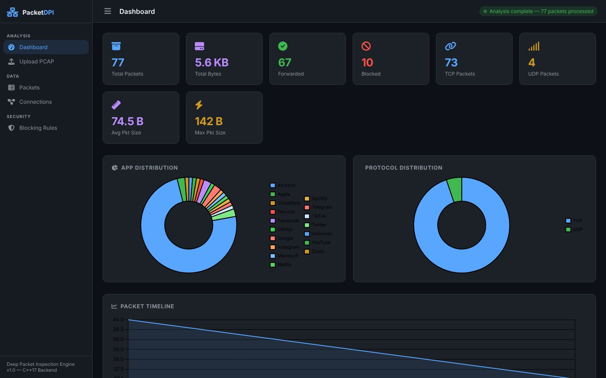
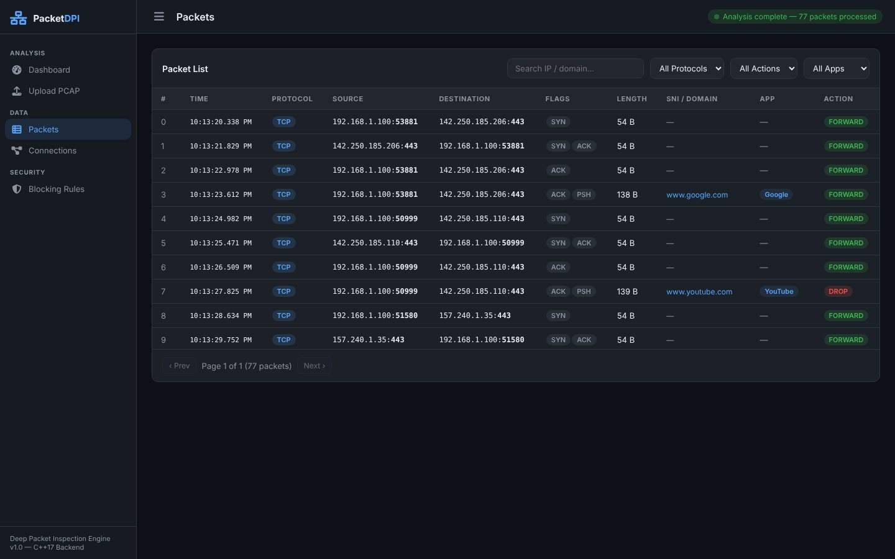
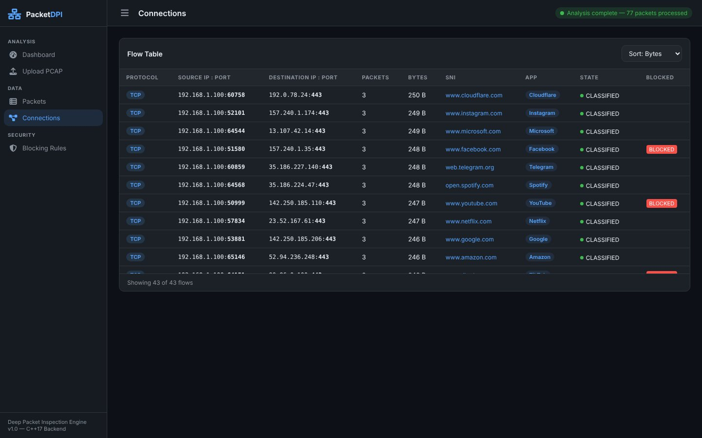
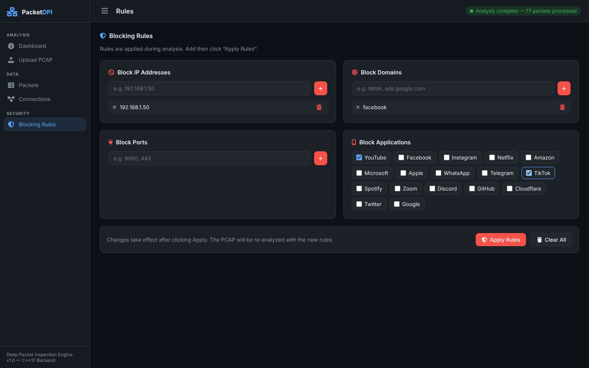
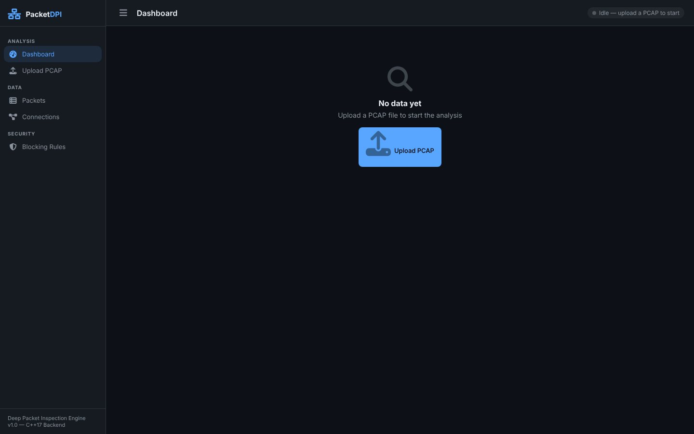
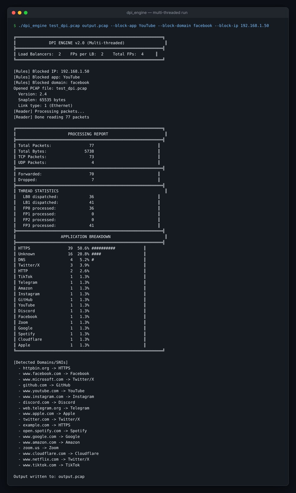

<div align="center">

# DPI Engine: Deep Packet Inspection in C++17


</div>

A deep packet inspection tool that reads PCAP captures, identifies the application behind each flow from the TLS SNI or HTTP Host header, applies blocking rules, and writes a filtered PCAP plus a traffic report. A small Flask web UI (**PacketDPI**) sits on top.

<p align="center">
  
</p>

## Screenshots

> Real captures: the sample capture from `generate_test_pcap.py` analysed with rules blocking `192.168.1.50`, `facebook`, YouTube and TikTok.

| Packet list (forward / drop per packet) | Flow table with SNI and app |
|:---:|:---:|
|  |  |
| **Blocking rules** | **Start screen** |
|  |  |

### Command-line engine

<p align="center">
  
</p>

## Features

- Parses Ethernet → IPv4 → TCP/UDP headers and tracks flows by 5-tuple.
- Extracts the domain from TLS ClientHello SNI or the HTTP Host header and classifies the application.
- Rule-based blocking by application, domain or IP.
- **Two engines:** a single-threaded version for learning (`src/main_working.cpp`) and a multi-threaded pipeline (`src/dpi_mt.cpp`): reader → load-balancer threads → fast-path threads → writer, with consistent hashing on the 5-tuple so each flow stays on one thread.
- No external C++ libraries required.

## Build

Requires g++ or clang++ with C++17.

```bash
# multi-threaded engine
g++ -std=c++17 -pthread -O2 -I include -o dpi_engine \
    src/dpi_mt.cpp src/pcap_reader.cpp src/packet_parser.cpp src/sni_extractor.cpp src/types.cpp

# single-threaded engine
g++ -std=c++17 -O2 -I include -o dpi_simple \
    src/main_working.cpp src/pcap_reader.cpp src/packet_parser.cpp src/sni_extractor.cpp src/types.cpp
```

## Run

```bash
python3 generate_test_pcap.py            # creates test_dpi.pcap with sample traffic
./dpi_engine test_dpi.pcap output.pcap
./dpi_engine test_dpi.pcap output.pcap --block-app YouTube --block-domain facebook --block-ip 192.168.1.50
./dpi_engine input.pcap output.pcap --lbs 4 --fps 4    # thread configuration
```

## Web UI

```bash
pip install -r requirements.txt     # Flask, gunicorn
python server.py                    # http://127.0.0.1:5000
```

`server.py` looks for a compiled `dpi_engine`/`dpi_simple` binary in the project folder, so build first. On Windows, `run.bat` automates the setup; see [`WINDOWS_SETUP.md`](WINDOWS_SETUP.md) and [`README_WEB.md`](README_WEB.md).

## Project layout

```
include/   headers (pcap reader, parser, SNI extractor, rule manager, connection tracker, thread-safe queue, ...)
src/       implementations and the two entry points
server.py  Flask web UI / API
templates/ web UI template
generate_test_pcap.py
```

## Learn more

[`docs/DPI_GUIDE.md`](docs/DPI_GUIDE.md) is a long walkthrough from networking basics (layers, 5-tuple, SNI) to the full code architecture and the journey of a packet through both engines.

## Author

Sanket Mali · [GitHub](https://github.com/Sanket1516)
